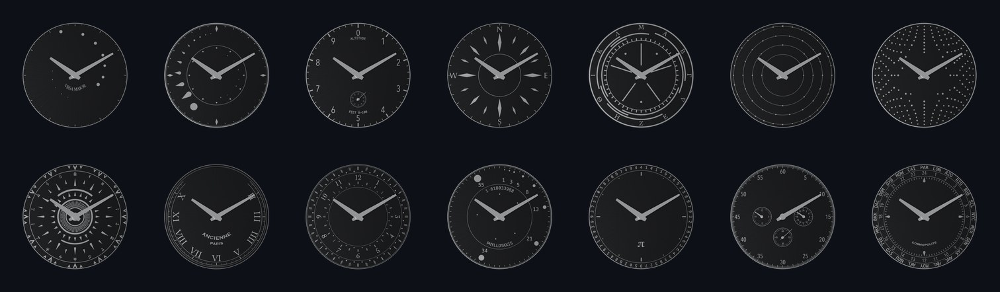

# WFDL gallery

A watch dial written as text. 58 original faces across seven families, compiled from a small dial description language.

**Try it in your browser:** [Open the live gallery](https://godofecht.github.io/wfdl-gallery/)

## What this is

WFDL is a small language for describing watch dials. A dial is a stack of rings, and each ring is one shape repeated around the circle. You write the rings as text. A compiler (a program that turns a description into something a computer can draw) places them, warns when two land on the same spot, and draws the face.

This repository holds the public gallery: one web page and the rendered images. It shows 58 original faces across seven families, from a total solar eclipse to a Maya count in base five. Each face is shown on a watch rendered in Blender, a free 3D graphics program.

The language, the compiler, the generator and the apps live in a separate repository. They are not included here.

## What you can learn from it

- How a design can be written as data and turned into a picture by a program (Computer Science).
- How number bases work: the "Other bases" family shows base five, base seven and base thirteen counting on a dial (Mathematics).
- How the golden angle and the Fibonacci sequence place seeds in a sunflower (Mathematics).
- How a static website is built from one HTML file, a stylesheet and a folder of images (Computer Science).
- How a CSS grid lays out a gallery that reflows on a phone screen (Computer Science).

## Run it

### In your browser

1. [Open the live gallery](https://godofecht.github.io/wfdl-gallery/).
2. Scroll down. Six large featured faces come first, then the seven families.

The page has no controls. It is a gallery to scroll through.

### On your own computer

**You will need:** a web browser. No other software. The page uses no JavaScript and loads every image from folders next to it.

1. On the repository page, choose **Code**, then **Download ZIP**.
2. Unzip the folder.
3. Double-click **index.html**. It opens in your browser.

You should see the heading "A watch dial, written as text." above six large watch images, then the gallery.

## How it works

The gallery is one hand-written HTML page. Each face is a `<figure>` element that holds an image and a caption. CSS (the language that sets colours, fonts and layout on a web page) arranges the figures into a grid that changes column count with the width of the screen.

The images were made elsewhere: each dial was written in WFDL, compiled, then rendered on a 3D watch in Blender.

| File or folder | What is in it |
|---|---|
| `index.html` | The whole page: styles, text and the list of faces |
| `faces/` | One PNG per face, named by family, for example `cat_astro_eclipse.png` |
| `heroes/` | Six large featured renders shown at the top of the page |
| `docs/gallery-contact-sheet.jpg` | The overview image used in this README |

The file name prefixes match the seven families:

| Prefix | Family | Faces |
|---|---|---|
| `cat_astro_` | Astronomy | 10 |
| `cat_inst_` | Instruments | 13 |
| `cat_cplx_` | Complications | 2 |
| `cat_math_` | Mathematics | 4 |
| `cat_exo_` | Other bases | 10 |
| `cat_trib_` | Ornament | 11 |
| `cat_dress_` | Dress | 8 |

## Ideas to try

1. Change the colour scheme. In `index.html`, edit the values under `:root`, such as `--gold` and `--bg`, and reload the page.
2. Write a caption for a face that has none. In `index.html`, find the figure for `faces/cat_inst_fathom.png` and add a `
` line like the ones on other faces.
3. Improve the alt text. Most images in `index.html` have alt text such as "Comet dial". Rewrite a few so they describe what a blind reader would want to know about the picture.
4. Change the grid. In `index.html`, the `.grid` rule sets a minimum tile width of 210 pixels. Try larger and smaller values and watch how the columns change.
5. Add a family filter. Write a short script in `index.html` that adds a button for each family and hides the other sections when one is pressed.

## Technical details

- The site is static. It has a `.nojekyll` file so GitHub Pages serves the files as they are, and Pages publishes from the root of the `main` branch.
- Every face image is a PNG of between about 380 and 520 KB. Hero images are close to 1 MB each.
- The page footer reads: "Drawn with WFDL and rendered in Blender. Every face is an original design."

## Project status

The gallery is complete and live. The WFDL language and compiler are not public in this repository, and the old README does not link to where they live.

## Licence

You can use, copy and change this work for any purpose, as long as you keep the copyright notice. See [LICENSE](LICENSE) (MIT).

## Credits

Designed and built by Abhishek Shivakumar. Renders made with [Blender](https://www.blender.org/). To cite this work, see [CITATION.cff](CITATION.cff).
